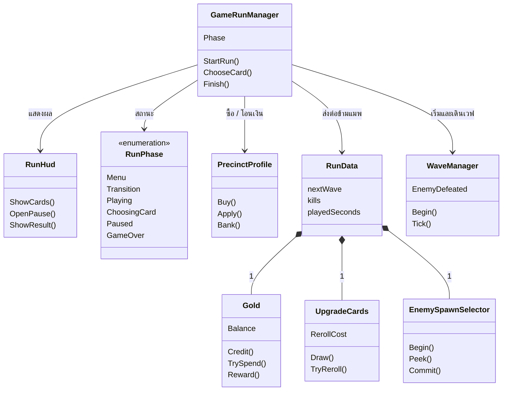
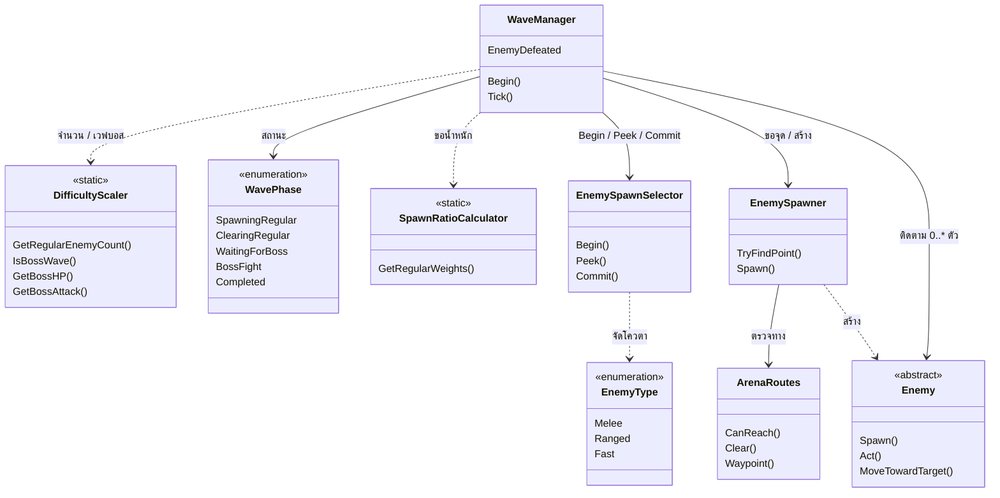
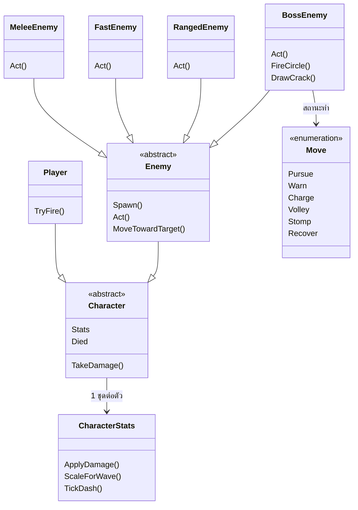
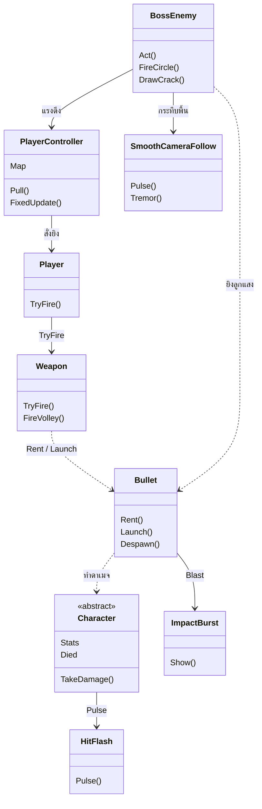
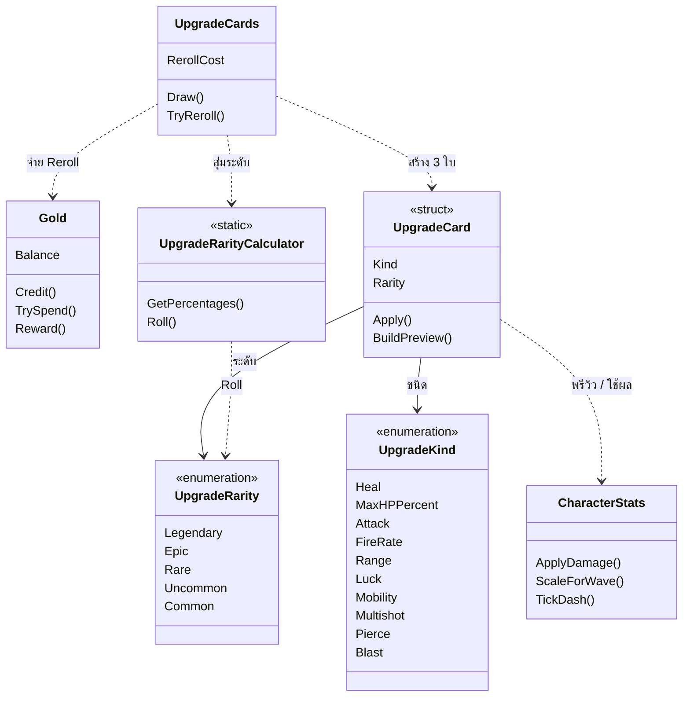
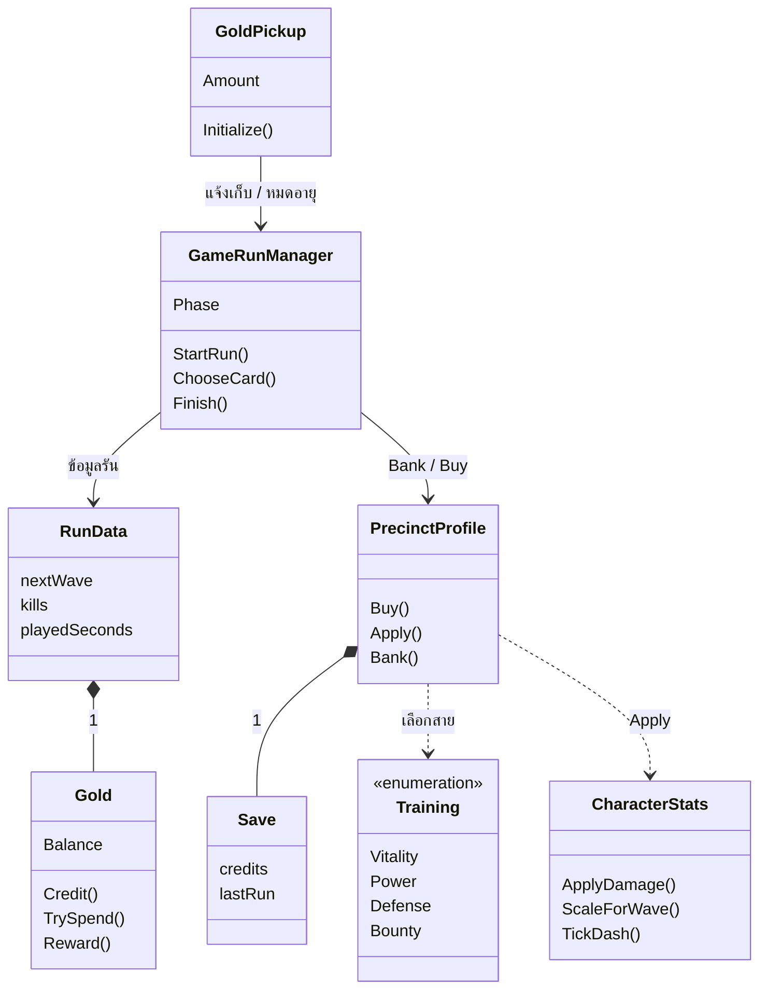
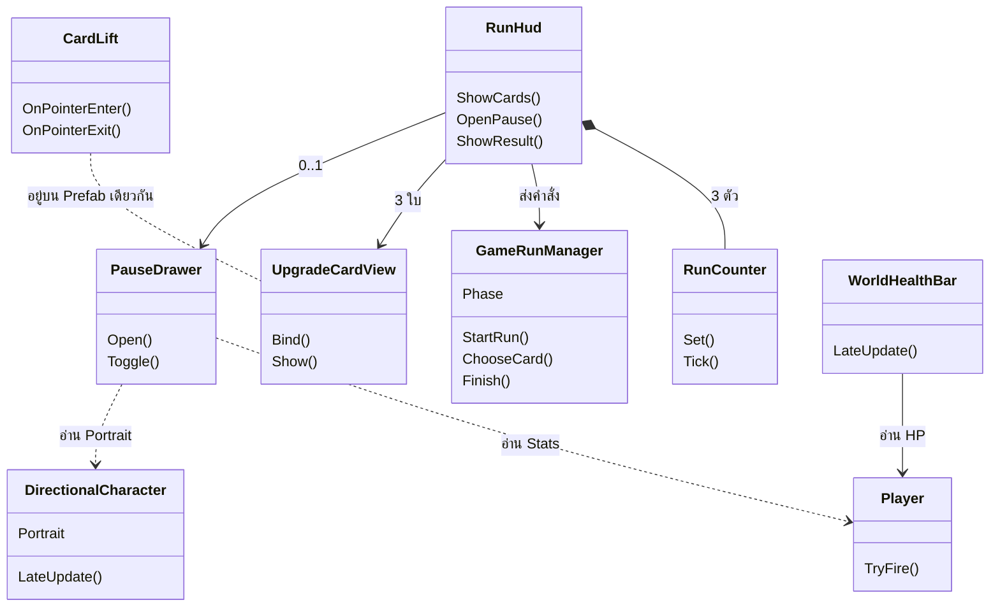

# ATM – Arrest That Man | Class Diagram

แผนภาพหลักใช้รูปแบบ UML จากรุ่น 17 พฤศจิกายน โดยเลือกสมาชิกที่อธิบายหน้าที่และการเชื่อมระบบจากสคริปต์ปัจจุบันทั้ง 33 ไฟล์ กล่องลูกชี้สามเหลี่ยมไปยังคลาสแม่ ข้าวหลามตัดอยู่ฝั่งเจ้าของ และตัวเลขปลายเส้นระบุจำนวน

[โค้ด Mermaid](CLASS_DIAGRAM.mmd) · [ภาพสำหรับซูม](CLASS_DIAGRAM.svg) · [รายละเอียดทุกสมาชิก](CLASS_DIAGRAM_FULL.mmd) · [ฉบับ draw.io](CLASS_DIAGRAM.drawio)

```mermaid
classDiagram
    direction TB

    class GameRunManager {
        <<MonoBehaviour>>
        -RunData data
        -WaveManager waves
        ~RunPhase Phase
        ~UpgradeCard[] Cards
        ~StartRun() void
        -BeginWave(int number) void
        ~TogglePause() void
        ~ChooseCard(int index) void
        -DrawMap(string previous) string$
        ~RerollCards() void
        ~Escape() void
        -Finish(bool escaped) void
    }

    class RunPhase {
        <<enumeration>>
        Menu
        Transition
        Playing
        ChoosingCard
        Paused
        GameOver
    }

    class RunData["GameRunManager.RunData"] {
        +Gold gold
        +UpgradeCards upgrades
        +EnemySpawnSelector selector
        +CharacterStats stats
        +int nextWave
        +int kills
        +double playedSeconds
    }

    class WaveManager {
        -HashSet~Enemy~ livingEnemies
        +int Number
        +WavePhase Phase
        +Action~Enemy~ EnemyDefeated
        +Begin(int number) void
        +Tick(float dt) void
        -RecordDefeat(Character character) void
    }

    class WavePhase {
        <<enumeration>>
        SpawningRegular
        ClearingRegular
        WaitingForBoss
        BossFight
        Completed
    }

    class EnemySpawner {
        -Transform[] edges
        -Transform[] center
        +TryFindPoint(bool boss, out Transform point) bool
        +Spawn(Transform point, bool boss, EnemyType type, int wave) Enemy
    }

    class EnemySpawnSelector {
        -int[] remaining
        -EnemyType[] slots
        +Begin(int[] weights, int count) void
        +Peek(int roll) EnemyType
        +Commit(int roll) void
    }

    class EnemyType {
        <<enumeration>>
        Melee
        Ranged
        Fast
    }

    class SpawnRatioCalculator {
        <<static>>
        +GetRegularWeights(int wave) int[]$
    }

    class ArenaRoutes {
        -float radius
        +CanReach(Vector2 position, Vector2 target) bool
        +Waypoint(Vector2 p, Vector2 target) Vector2
    }

    class DifficultyScaler {
        <<static>>
        +GetRegularEnemyCount(int wave) int$
        +IsBossWave(int wave) bool$
        +GetBossHP(int wave) float$
        +GetBossAttack(int wave) float$
        +ScaleHP(float baseHP, int wave) float$
        +ScaleAttack(float baseAttack, int wave) float$
        +ScaleDefense(float baseDefense, int wave) float$
    }

    class Character {
        <<abstract>>
        +CharacterStats Stats
        +bool IsAlive
        +Action~Character~ Died
        +TakeDamage(float damage) float
        +Heal(float amount) void
        #OnDeath() void*
    }

    class CharacterStats {
        +float MaxHP
        +float CurrentHP
        +float AttackDamage
        +float Defense
        +int Pierce
        +float Splash
        +float Barrier
        +double Luck
        +int DashCapacity
        ~ScaleForWave(int wave, bool isBoss) void
        ~ApplyDamage(float amount) float
    }

    class Player {
        -Weapon weapon
        +TryFire(Vector2 direction, Vector2? aimPoint) bool
    }

    class PlayerController {
        <<MonoBehaviour>>
        ~Pull(Vector2 velocity) void
        ~SpriteRenderer Map
        -FixedUpdate() void
        -LateUpdate() void
    }

    class Enemy {
        <<abstract>>
        #Player Target
        ~Spawn(Player player, Collider2D playerHitbox, int wave, ArenaRoutes routes) void
        #Act() void*
        #MoveTowardTarget() void
    }

    class MeleeEnemy {
        #Act() void
    }

    class FastEnemy {
        #Act() void
    }

    class RangedEnemy {
        -LineRenderer beam
        -float windup
        -bool aiming
        #Act() void
    }

    class BossEnemy {
        -Bullet orb
        -Move move
        #Act() void
        -FireCircle(float offset) void
        -Blocked(Vector2 direction, float distance) bool
        -DrawCrack(float extent, float width, Color color) void
    }

    class Move["BossEnemy.Move"] {
        <<enumeration>>
        Pursue
        Warn
        Charge
        Volley
        Stomp
        Recover
    }

    class Weapon {
        <<MonoBehaviour>>
        -Transform firePoint1
        -Transform firePoint2
        -float spreadAngle
        +TryFire(Character owner, Vector2 direction, Vector2? aimPoint) bool
        -FireVolley(Character owner, Vector3 origin, Vector2 direction, CharacterStats stats) void
    }

    class Bullet {
        <<MonoBehaviour>>
        -Stack~Bullet~ inactive
        -Character owner
        +Rent(Bullet prefab, Vector3 position, Quaternion rotation) Bullet$
        +Launch(Character owner, Vector2 direction, float speed, float range, float damage) void
        -Explode(Vector2 center, Character primary) void
        +Despawn() void
    }

    class ImpactBurst {
        <<MonoBehaviour>>
        -Stack~ImpactBurst~ idle
        +Show(Vector2 position, float radius) void
    }

    class HitFlash {
        <<MonoBehaviour>>
        -double MinimumInterval$
        +Pulse() void
    }

    class DirectionalCharacter {
        <<MonoBehaviour>>
        ~Sprite Portrait
        -LateUpdate() void
    }

    class SmoothCameraFollow {
        <<MonoBehaviour>>
        -Transform target
        ~Tremor(float strength) void
        +Pulse() void
    }

    class Gold {
        +BigInteger Earned
        +BigInteger Spent
        +long Balance
        +Reward(int wave, int bonusLevel) long$
        +Credit(long reward) void
        +TrySpend(long amount) bool
    }

    class GoldPickup {
        <<MonoBehaviour>>
        ~long Amount
        ~Initialize(GameRunManager manager, Transform player, long amount) void
    }

    class PrecinctProfile {
        +long Credits
        +Price(Training track) BigInteger
        +Buy(Training track) void
        +Bank(string runId, long amount) void
        +Apply(CharacterStats stats) void
    }

    class Training {
        <<enumeration>>
        Vitality
        Power
        Defense
        Bounty
    }

    class Save["PrecinctProfile.Save"] {
        +long credits
        +int vitality
        +int power
        +int defense
        +int bounty
        +string lastRun
    }

    class UpgradeCards {
        +long RerollCost
        +Draw(int wave, CharacterStats stats) UpgradeCard[]
        +TryReroll(int wave, CharacterStats stats, Gold gold, out UpgradeCard[] offer) bool
    }

    class UpgradeCard {
        <<struct>>
        +UpgradeKind Kind
        +UpgradeRarity Rarity
        +Apply(CharacterStats stats) void
        +BuildPreview(CharacterStats before) string
    }

    class UpgradeKind {
        <<enumeration>>
        Heal
        MaxHPPercent
        Attack
        FireRate
        Range
        Luck
        Mobility
        Multishot
        Pierce
        Blast
    }

    class UpgradeRarity {
        <<enumeration>>
        Legendary
        Epic
        Rare
        Uncommon
        Common
    }

    class UpgradeRarityCalculator {
        <<static>>
        +GetPercentages(int wave, double luck) double[]$
        +Roll(int wave, double luck) UpgradeRarity$
        +Roll(double[] percentages) UpgradeRarity$
    }

    class RunHud {
        <<MonoBehaviour>>
        -UpgradeCardView[] cardViews
        ~OpenPause(Player player, int wave, long gold, int kills, double seconds, decimal multiplier) void
        ~ShowMenu(PrecinctProfile profile) void
        ~ShowCharacter(PrecinctProfile profile) void
        ~ShowCards(UpgradeCard[] cards, CharacterStats stats) void
        ~ShowResult(bool escaped, long score, int wave, int kills, Gold gold, double seconds) void
    }

    class UpgradeCardView {
        <<MonoBehaviour>>
        ~Bind(Action onSelected) void
        ~Show(UpgradeCard card, CharacterStats stats) void
    }

    class CardLift {
        <<MonoBehaviour>>
        +OnPointerEnter(PointerEventData e) void
        +OnPointerExit(PointerEventData e) void
    }

    class PauseDrawer {
        <<MonoBehaviour>>
        ~Bind(GameRunManager run, Action closed) void
        ~Open(Player player, int wave, long gold, int kills, double seconds, decimal multiplier) void
        ~Toggle() void
    }

    class RunCounter {
        +long Value
        +Set(long amount) void
        +Tick(float dt) bool
    }

    class WorldHealthBar {
        <<MonoBehaviour>>
        -RectTransform healthFill
        -LateUpdate() void
    }

    Character <|-- Player
    Character <|-- Enemy
    Enemy <|-- MeleeEnemy
    Enemy <|-- FastEnemy
    Enemy <|-- RangedEnemy
    Enemy <|-- BossEnemy
    GameRunManager --> RunPhase : current phase
    GameRunManager --> RunData : transfers across maps
    GameRunManager *-- "0..1" WaveManager : drives waves in arena
    GameRunManager --> Player : listens for death
    GameRunManager --> RunHud : presents run state
    GameRunManager --> PrecinctProfile : buys training and banks escape
    RunData *-- "1" EnemySpawnSelector : carries spawn quota
    RunData *-- "1" Gold : run wallet
    RunData *-- "1" UpgradeCards : rerolls this run
    RunData --> "0..1" CharacterStats : carries between arenas
    WaveManager --> WavePhase : wave state
    WaveManager ..> DifficultyScaler : count and boss schedule
    WaveManager ..> SpawnRatioCalculator : gets weights
    WaveManager --> EnemySpawnSelector : Begin / Peek / Commit
    EnemySpawnSelector ..> EnemyType : reserves slots
    WaveManager --> EnemySpawner : requests marker then spawn
    WaveManager --> "0..*" Enemy : tracks living enemies
    EnemySpawner --> ArenaRoutes : checks reachability
    EnemySpawner ..> Enemy : instantiates prefab
    Enemy --> ArenaRoutes : routes around obstacles
    Enemy --> Player : pursues
    Character --> "1" CharacterStats : health and combat stats
    CharacterStats ..> DifficultyScaler : scales spawned enemy
    PlayerController --> Player : movement and firing input
    Player --> Weapon : fires through
    Weapon --> Bullet : rents from prefab pool
    BossEnemy --> Bullet : rents volley orbs
    BossEnemy --> Move : attack state
    BossEnemy --> PlayerController : stomp pulls player
    BossEnemy --> SmoothCameraFollow : stomp tremor
    SmoothCameraFollow --> PlayerController : reads map bounds
    Bullet --> Character : owner and hit target
    Bullet --> ImpactBurst : splash feedback
    Character --> HitFlash : damage feedback
    GameRunManager --> GoldPickup : drops on enemy defeat
    GoldPickup --> GameRunManager : collect or expire
    GameRunManager ..> Gold : credits pickups
    PrecinctProfile *-- "1" Save : persists credits and levels
    PrecinctProfile ..> Training : buys track
    PrecinctProfile ..> CharacterStats : applies permanent stats
    UpgradeCards ..> UpgradeRarityCalculator : rolls each tier
    UpgradeRarityCalculator ..> UpgradeRarity : returns tier
    UpgradeCards ..> UpgradeCard : draws three offers
    UpgradeCards ..> Gold : spends on reroll
    UpgradeCard --> UpgradeKind : effect type
    UpgradeCard --> UpgradeRarity : tier
    UpgradeCard ..> CharacterStats : previews and applies
    GameRunManager --> "0..3" UpgradeCard : active offer
    RunHud --> GameRunManager : forwards commands
    RunHud --> "3" UpgradeCardView : shows choices
    UpgradeCardView ..> UpgradeCard : displays offer
    CardLift .. UpgradeCardView : same card prefab
    RunHud --> "0..1" PauseDrawer : opens during run
    PauseDrawer ..> DirectionalCharacter : reads portrait
    PauseDrawer ..> CharacterStats : displays live stats
    RunHud *-- "3" RunCounter : animates totals
    WorldHealthBar --> Player : reads current health

    class MonoBehaviour
    class IDisposable {
        <<interface>>
    }
    class IPointerEnterHandler {
        <<interface>>
    }
    class IPointerExitHandler {
        <<interface>>
    }
    MonoBehaviour <|-- Bullet
    MonoBehaviour <|-- CardLift
    MonoBehaviour <|-- Character
    MonoBehaviour <|-- DirectionalCharacter
    MonoBehaviour <|-- GameRunManager
    MonoBehaviour <|-- GoldPickup
    MonoBehaviour <|-- HitFlash
    MonoBehaviour <|-- ImpactBurst
    MonoBehaviour <|-- PauseDrawer
    MonoBehaviour <|-- PlayerController
    MonoBehaviour <|-- RunHud
    MonoBehaviour <|-- SmoothCameraFollow
    MonoBehaviour <|-- UpgradeCardView
    MonoBehaviour <|-- Weapon
    MonoBehaviour <|-- WorldHealthBar
    IDisposable <|.. WaveManager
    IPointerEnterHandler <|.. CardLift
    IPointerExitHandler <|.. CardLift
```

## ภาพรวมรัน

GameRunManager เริ่มเวฟ รับผลการต่อสู้ แสดงการ์ด และส่ง RunData ไปแมพถัดไป

## เวฟและจุดเกิด

WaveManager เตรียมโควตา → ขอจุดเกิด → Peek → Spawn → Commit เมื่อสร้างสำเร็จ

## ตัวละครและศัตรู

สามเหลี่ยมชี้ไปยังคลาสแม่ ศัตรูทั้งสี่ชนิดใช้การรับดาเมจและสเตตัสของ Character ร่วมกัน

## การยิงและผลกระทบ

ปืนและท่ายิงลูกแสงของบอสยืม Bullet จาก Pool ของ Prefab กระสุนแต่ละแบบ

## การ์ดและ Reroll

หลังเคลียร์เวฟ สุ่มแต่ละใบจาก Wave และ Luck เลือกหนึ่งใบเพื่อเปลี่ยน Stats ของรัน

## เหรียญและอัปเกรดถาวร

ยอด Gold เข้ารันเมื่อเก็บเหรียญ หนีสำเร็จจึงโอนยอดคงเหลือเป็น Credits

## หน้าจอและการ์ดบน Canvas

RunHud เปิดเมนู เลือกการ์ด แสดงผล และเชื่อม callback กลับไปยัง GameRunManager

## อ่านข้ามระบบ

- **เวฟ 10** เริ่มด้วยศัตรูปกติ 14 ตัวที่น้ำหนัก 60/25/15 โควตาแรกของช่วงนี้เป็น Melee 8, Ranged 4, Fast 2 หลังเจอจุดเกิดที่เดินถึงผู้เล่นได้ จึงสุ่มช่องจากกลุ่มไม่เกิน 4 แล้วหักยอดหลังสร้างสำเร็จ เมื่อศัตรูปกติหมด บอสจึงเกิดและต้องถูกกำจัดก่อนเปิดการ์ด
- **การต่อสู้** Enemy เก็บ Player เป็นเป้าหมาย RangedEnemy ตรวจ Raycast และวาดเลเซอร์ด้วย LineRenderer ส่วน BossEnemy ใช้ Bullet สำหรับ Volley และเรียก PlayerController.Pull กับ SmoothCameraFollow.Tremor ขณะกระทืบพื้น CharacterStats ใช้ DifficultyScaler ตอนเกิด บอสเวฟ 10/20 มี HP 2,500/4,200, ATK 150/200 และ DEF เท่ากับเลขเวฟ
- **แมพและข้อมูลรัน** SampleScene เป็นเมนู StartRun สุ่มหนึ่งใน MAP 1–3 หลังเลือกการ์ดของเวฟบอส Travel ส่ง RunData ไปแมพถัดไปที่ต่างจากแมพก่อนหน้า แต่ละแมพสร้าง WaveManager, EnemySpawner และ ArenaRoutes ของตัวเอง
- **เงิน** Enemy.Died → WaveManager.EnemyDefeated → GameRunManager.DropGold สร้าง GoldPickup เมื่อผู้เล่นเก็บ GameRunManager.Collect จึงเพิ่มยอดใน Gold การหนีโอนยอดหลังหัก Reroll ผ่าน PrecinctProfile.Bank การตายหรือ Forfeit ให้ Score และ Credits เป็นศูนย์
- **Canvas** RunHud ดูแลหน้าเมนู การ์ด ผลรัน และสร้าง PauseDrawer จาก Resources เมื่อเปิดครั้งแรก การพักหยุดเวลาเกมจนแถบเลื่อนปิดเสร็จ WorldHealthBar อ่าน HP จาก Player บนตัวละคร ส่วน CardLift รับ pointer event บน UpgradeCard prefab
- **ชนิดซ้อน** RunData อยู่ภายใน GameRunManager, Save อยู่ภายใน PrecinctProfile และ Move อยู่ภายใน BossEnemy ส่วนคลาสเกมที่ผูกกับ Unity, enum และ struct ใช้ชื่อเดียวกับซอร์สในตารางด้านล่าง

## ดัชนีซอร์ส

| ชนิด | หน้าที่ | เปิดโค้ด |
|---|---|---|
| SmoothCameraFollow | ติดตามผู้เล่นและสั่นเมื่อเกิดแรงกระแทก | [SmoothCameraFollow.cs L6](Assets/Scripts/Camera/SmoothCameraFollow.cs#L6) |
| Character | สเตตัส การรับดาเมจ และเหตุการณ์ตาย | [Character.cs L6](Assets/Scripts/Characters/Character.cs#L6) |
| CharacterStats | HP การโจมตี เกราะ การเคลื่อนที่ และโบนัส | [CharacterStats.cs L8](Assets/Scripts/Characters/CharacterStats.cs#L8) |
| DirectionalCharacter | เลือกสไปรต์ตามทิศและความเร็ว | [DirectionalCharacter.cs L5](Assets/Scripts/Characters/DirectionalCharacter.cs#L5) |
| Player | ตัวละครที่ผู้เล่นควบคุม | [Player.cs L6](Assets/Scripts/Characters/Player.cs#L6) |
| PlayerController | รับอินพุต เดิน เล็ง ยิง และ Dash | [PlayerController.cs L9](Assets/Scripts/Characters/PlayerController.cs#L9) |
| Bullet | ยืมกระสุน ตรวจการชน และคืนเข้า Pool | [Bullet.cs L6](Assets/Scripts/Combat/Bullet.cs#L6) |
| HitFlash | แสดงแฟลชขาวหลังรับดาเมจ | [HitFlash.cs L6](Assets/Scripts/Combat/HitFlash.cs#L6) |
| ImpactBurst | เล่นเอฟเฟกต์ Blast และนำกลับมาใช้ซ้ำ | [ImpactBurst.cs L6](Assets/Scripts/Combat/ImpactBurst.cs#L6) |
| Weapon | ยิงสลับปากกระบอกและกระจายกระสุน | [Weapon.cs L6](Assets/Scripts/Combat/Weapon.cs#L6) |
| RunPhase | สถานะรัน | [GameRunManager.cs L9](Assets/Scripts/Core/GameRunManager.cs#L9) |
| GameRunManager | ควบคุมรันและเปลี่ยนแมพ | [GameRunManager.cs L12](Assets/Scripts/Core/GameRunManager.cs#L12) |
| RunData | ข้อมูลของรันที่ส่งต่อข้ามแมพ | [GameRunManager.cs L25](Assets/Scripts/Core/GameRunManager.cs#L25) |
| Gold | ยอดเก็บ ยอดจ่าย และเงินคงเหลือของรัน | [Gold.cs L6](Assets/Scripts/Economy/Gold.cs#L6) |
| GoldPickup | เหรียญบนพื้น เคลื่อนเข้าหาผู้เล่นเมื่อใกล้ | [GoldPickup.cs L5](Assets/Scripts/Economy/GoldPickup.cs#L5) |
| Training | สายอัปเกรดถาวร | [PrecinctProfile.cs L5](Assets/Scripts/Economy/PrecinctProfile.cs#L5) |
| PrecinctProfile | ซื้ออัปเกรดถาวรและบันทึก Credits | [PrecinctProfile.cs L7](Assets/Scripts/Economy/PrecinctProfile.cs#L7) |
| Save | ข้อมูลถาวรที่บันทึกใน PlayerPrefs | [PrecinctProfile.cs L10](Assets/Scripts/Economy/PrecinctProfile.cs#L10) |
| BossEnemy | พุ่งชน ยิงลูกแสง และกระทืบพื้น | [BossEnemy.cs L7](Assets/Scripts/Enemies/BossEnemy.cs#L7) |
| Move | สถานะท่าบอส | [BossEnemy.cs L9](Assets/Scripts/Enemies/BossEnemy.cs#L9) |
| Enemy | ติดตามเป้าหมายและเลือกพฤติกรรมโจมตี | [Enemy.cs L7](Assets/Scripts/Enemies/Enemy.cs#L7) |
| FastEnemy | ไล่เข้าประชิดด้วยความเร็วของสาย Fast | [FastEnemy.cs L3](Assets/Scripts/Enemies/FastEnemy.cs#L3) |
| MeleeEnemy | ไล่เข้าประชิดและโจมตี | [MeleeEnemy.cs L3](Assets/Scripts/Enemies/MeleeEnemy.cs#L3) |
| RangedEnemy | เล็งและยิงเลเซอร์ด้วย Raycast | [RangedEnemy.cs L6](Assets/Scripts/Enemies/RangedEnemy.cs#L6) |
| CardLift | ยกการ์ดเมื่อชี้เมาส์ | [CardLift.cs L6](Assets/Scripts/UI/CardLift.cs#L6) |
| PauseDrawer | แถบพักเกม แสดงรูปและ Stats ปัจจุบัน | [PauseDrawer.cs L9](Assets/Scripts/UI/PauseDrawer.cs#L9) |
| RunCounter | ทำให้ตัวเลขบน UI วิ่งเข้าหายอดจริง | [RunCounter.cs L6](Assets/Scripts/UI/RunCounter.cs#L6) |
| RunHud | เชื่อมปุ่ม Canvas กับคำสั่งในรัน | [RunHud.cs L9](Assets/Scripts/UI/RunHud.cs#L9) |
| UpgradeCardView | แสดงการ์ดหนึ่งใบและรับการเลือก | [UpgradeCardView.cs L8](Assets/Scripts/UI/UpgradeCardView.cs#L8) |
| WorldHealthBar | แสดงสัดส่วน HP ใต้ผู้เล่น | [WorldHealthBar.cs L6](Assets/Scripts/UI/WorldHealthBar.cs#L6) |
| UpgradeKind | ชนิดเอฟเฟกต์การ์ด | [UpgradeCards.cs L5](Assets/Scripts/Upgrades/UpgradeCards.cs#L5) |
| UpgradeCard | ชนิด ระดับ และผลของการ์ดหนึ่งใบ | [UpgradeCards.cs L7](Assets/Scripts/Upgrades/UpgradeCards.cs#L7) |
| UpgradeCards | สุ่มสามตัวเลือกและคิดราคา Reroll | [UpgradeCards.cs L99](Assets/Scripts/Upgrades/UpgradeCards.cs#L99) |
| UpgradeRarity | ระดับความหายาก | [UpgradeRarityCalculator.cs L4](Assets/Scripts/Upgrades/UpgradeRarityCalculator.cs#L4) |
| UpgradeRarityCalculator | คำนวณโอกาสจากเวฟและ Luck | [UpgradeRarityCalculator.cs L17](Assets/Scripts/Upgrades/UpgradeRarityCalculator.cs#L17) |
| ArenaRoutes | ตรวจทางถึงผู้เล่นและหาจุดเดินถัดไป | [ArenaRoutes.cs L8](Assets/Scripts/Waves/ArenaRoutes.cs#L8) |
| DifficultyScaler | คำนวณจำนวนศัตรูและสเกลสเตตัส | [DifficultyScaler.cs L5](Assets/Scripts/Waves/DifficultyScaler.cs#L5) |
| EnemyType | ประเภทในโควตาศัตรูทั่วไป | [EnemySpawnSelector.cs L5](Assets/Scripts/Waves/EnemySpawnSelector.cs#L5) |
| EnemySpawnSelector | เก็บรายชื่อและยอดศัตรูที่ยังต้องปล่อย | [EnemySpawnSelector.cs L9](Assets/Scripts/Waves/EnemySpawnSelector.cs#L9) |
| EnemySpawner | หาจุดเกิดและสร้าง Prefab | [EnemySpawner.cs L6](Assets/Scripts/Waves/EnemySpawner.cs#L6) |
| SpawnRatioCalculator | อ่านสัดส่วนศัตรูตามเวฟ | [SpawnRatioCalculator.cs L5](Assets/Scripts/Waves/SpawnRatioCalculator.cs#L5) |
| WavePhase | สถานะภายในเวฟ | [WaveManager.cs L7](Assets/Scripts/Waves/WaveManager.cs#L7) |
| WaveManager | ปล่อยศัตรูและตัดสินว่าเวฟจบหรือยัง | [WaveManager.cs L9](Assets/Scripts/Waves/WaveManager.cs#L9) |

เครื่องมือทดสอบสัดส่วนใน Editor อยู่ที่ [SpawnQuotaChecks.cs](Assets/Editor/SpawnQuotaChecks.cs) รันผ่าน Tools → ATM → Check Spawn Ratios
