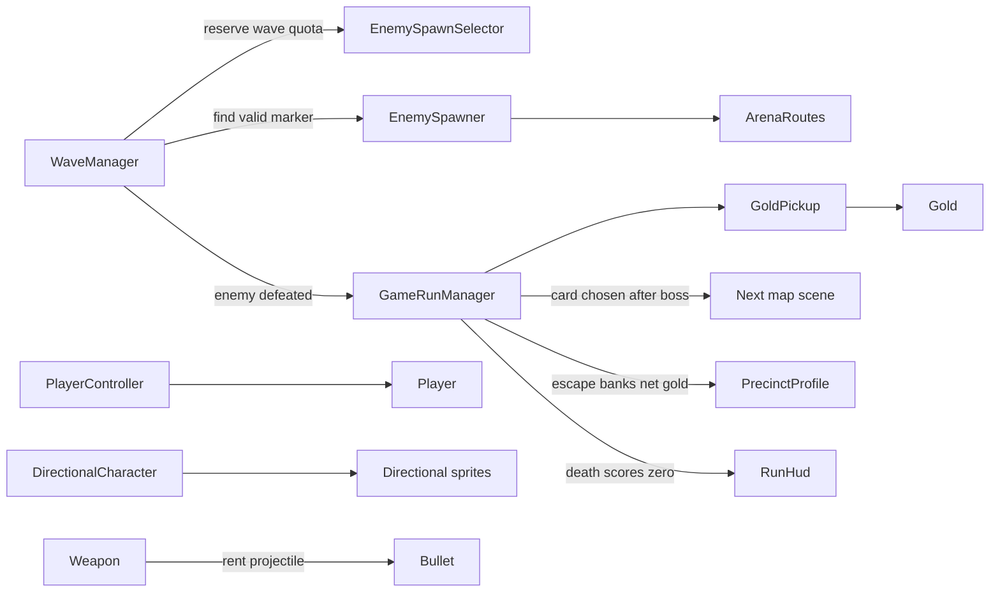

# ATM - Arrest That Man — Class Diagram Update

ตรวจเทียบสคริปต์เกม 24 ไฟล์ใน `Assets/Scripts` กับ `SampleScene` และ Prefab ที่บันทึกไว้ ณ 17 พฤศจิกายน 2026 ใช้ [GAME_DESIGN.md](GAME_DESIGN.md) เป็นเกณฑ์เทียบ

## ระบบที่เปลี่ยนในวันที่ 23 พฤศจิกายน 2026

`EnemySpawnSelector.Begin(weights, count)` เตรียมโควตารายเวฟ `EnemySpawner.TryFindPoint` คัดจุดตามพื้นที่และกล้อง แล้ว `Peek / Spawn / Commit` สร้างศัตรูก่อนหักโควตา Run ถือ selector ไว้ข้ามแมพ RangedEnemy ใช้ LineRenderer และ Raycast ยิงเลเซอร์ Weapon ใช้กระสุนซ้ำจาก Pool ดูกติกาและตารางการ์ดปัจจุบันใน [GAME_DESIGN.md](GAME_DESIGN.md)

## ภาพโครงสร้างก่อนปรับระบบ (17 พฤศจิกายน 2026)

แผนภาพและตารางด้านล่างบันทึก Prototype รุ่นก่อนเพิ่มเมนู ระบบโควตา แมพหมุนเวียน และ Training

แสดงสมาชิกหลักที่ใช้เชื่อมระบบ `+` คือ public, `-` คือ private, `#` คือ protected และ `~` คือ internal

```mermaid
classDiagram
    direction TB
    class GameRunManager {
        <<MonoBehaviour>>
        -Player player
        -WaveManager waves
        -Gold gold
        -UpgradeCards upgrades
        ~RunPhase Phase
        ~UpgradeCard[] Cards
        ~int WaveNumber
        -BeginWave(int number) void
        ~ChooseCard(int index) void
        ~RerollCards() void
        -EndRun(Character dead) void
        ~Restart() void
    }
    class RunPhase {
        <<enumeration>>
        Playing
        ChoosingCard
        GameOver
    }
    class WaveManager {
        -HashSet~Enemy~ livingEnemies
        -Enemy pendingPrefab
        -int regularTarget
        -int regularSpawned
        +int Number
        +WavePhase Phase
        +bool Cleared
        +Action EnemyDefeated
        +Begin(int number) void
        +Tick(float dt) void
        -RecordDefeat(Character character) void
        +Dispose() void
    }
    class WavePhase {
        <<enumeration>>
        SpawningRegular
        ClearingRegular
        WaitingForBoss
        BossFight
        Completed
    }
    class EnemySpawner {
        -Transform[] spawnPoints
        -Enemy[] regularPrefabs
        -BossEnemy[] bossPrefabs
        -float minimumDistanceSquared
        +GetRegularPrefab(EnemyType type) Enemy
        +PickBossPrefab() BossEnemy
        +TrySpawn(Enemy prefab, int wave, out Enemy enemy) bool
    }
    class EnemySpawnSelector {
        -int[] cumulativeWeights
        +int TotalWeight
        +SelectByRoll(int roll) EnemyType
    }
    class EnemyType {
        <<enumeration>>
        Melee
        Ranged
        Fast
    }
    class SpawnRatioCalculator {
        +GetRegularWeights(int wave)$ int[]
    }
    class DifficultyScaler {
        +GetRegularEnemyCount(int wave)$ int
        +IsBossWave(int wave)$ bool
        +ScaleHP(float baseHP, int wave)$ float
        +ScaleAttack(float baseAttack, int wave)$ float
        +ScaleDefense(float baseDefense, int wave)$ float
    }
    class Character {
        <<abstract>>
        -CharacterStats stats
        +CharacterStats Stats
        +bool IsAlive
        +Action~Character~ Died
        +TakeDamage(float damage) float
        +Heal(float amount) void
        #CreateDefaultStats()* CharacterStats
        #OnDeath()* void
    }
    class CharacterStats {
        +float MaxHP
        +float CurrentHP
        +float MoveSpeed
        +float AttackSpeed
        +float AttackDamage
        +float Defense
        +float ProjectileRange
        +int ProjectileCount
        +float Barrier
        +double Luck
        ~ScaleForWave(int wave) void
        ~ApplyDamage(float amount) float
        ~IncreaseMaxHP(float percentage) void
        ~IncreaseAttack(float percentage) void
        ~IncreaseFireRate(float percentage) void
        ~IncreaseRange(float percentage) void
        ~IncreaseLuck(float amount) void
        ~AddBarrier(float amount) void
        ~CopyForPreview() CharacterStats
    }
    class Player {
        -Weapon weapon
        +TryFire(Vector2 direction, Vector2? aimPoint) bool
    }
    class PlayerController {
        <<MonoBehaviour>>
        -Camera aimCamera
        -Rigidbody2D movementBody
        ~SpriteRenderer Map
        -Update() void
        -FixedUpdate() void
        -LateUpdate() void
    }
    class Enemy {
        <<abstract>>
        #Player Target
        #Rigidbody2D Body
        ~float SpawnClearance
        ~Spawn(Player player, Collider2D playerHitbox, int wave) void
        #Act()* void
        #ChaseAndAttack() void
        #TryStartAttack() bool
    }
    class MeleeEnemy {
        #Act() void
    }
    class RangedEnemy {
        -Bullet projectilePrefab
        -float attackRange
        #Act() void
    }
    class FastEnemy {
        #Act() void
    }
    class BossEnemy {
        #Act() void
    }
    class Weapon {
        <<MonoBehaviour>>
        -Bullet bulletPrefab
        -float spreadAngle
        -double nextShotTime
        +TryFire(Character owner, Vector2 direction, Vector2? aimPoint) bool
    }
    class Bullet {
        <<MonoBehaviour>>
        -Character owner
        -float damage
        -float remainingRange
        +Launch(Character owner, Vector2 direction, float speed, float range, float damage) void
        -TryGetImpact(float distance, out Character target, out float contact) bool
        +Despawn() void
    }
    class SmoothCameraFollow {
        <<MonoBehaviour>>
        -Transform target
        -PlayerController playerController
        -float preferredSize
        -LateUpdate() void
        -ClampCenter(Vector2 position, Vector2 min, Vector2 max)$ Vector2
    }
    class Gold {
        +long Balance
        +CreditEnemyDefeat(int wave) void
        +TrySpend(long amount) bool
    }
    class UpgradeCards {
        -int successfulRerolls
        +long RerollCost
        +Draw(int wave, double luck) UpgradeCard[]
        +TryReroll(int wave, double luck, Gold gold, out UpgradeCard[] offer) bool
    }
    class UpgradeCard {
        <<struct>>
        +UpgradeKind Kind
        +UpgradeRarity Rarity
        +string Title
        +string Numeral
        +string EffectText
        +Apply(CharacterStats stats) void
        +BuildPreview(CharacterStats before) string
    }
    class UpgradeKind {
        <<enumeration>>
        Heal
        MaxHPPercent
        Attack
        FireRate
        Range
        Luck
    }
    class UpgradeRarity {
        <<enumeration>>
        Legendary
        Epic
        Rare
        Uncommon
        Common
    }
    class UpgradeRarityCalculator {
        +GetPercentages(int wave, double luck)$ double[]
        +Roll(double[] percentages)$ UpgradeRarity
    }
    class RunHud {
        <<MonoBehaviour>>
        -UpgradeCardView[] cardViews
        ~Initialize(GameRunManager runManager) void
        ~ShowWave(int number) void
        ~ShowGold(long gold, long cost) void
        ~ShowCards(UpgradeCard[] cards, CharacterStats stats) void
        ~ShowGameOver(int wave) void
    }
    class UpgradeCardView {
        <<MonoBehaviour>>
        -Button button
        -Image artwork
        -TMP_Text title
        -TMP_Text tier
        -TMP_Text effect
        -TMP_Text preview
        ~Bind(Action onSelected) void
        ~Show(UpgradeCard card, CharacterStats stats) void
    }
    class WorldHealthBar {
        <<MonoBehaviour>>
        -RectTransform healthFill
        -LateUpdate() void
    }

    Character <|-- Player
    Character <|-- Enemy
    Enemy <|-- MeleeEnemy
    Enemy <|-- RangedEnemy
    Enemy <|-- FastEnemy
    Enemy <|-- BossEnemy
    Character "1" *-- "1" CharacterStats
    CharacterStats ..> DifficultyScaler : scales base stats
    PlayerController "1" --> "1" Player : input
    Player "1" --> "1" Weapon : fires through
    Enemy "0..*" --> "1" Player : targets
    Weapon ..> Bullet : launches
    RangedEnemy ..> Bullet : launches
    Bullet "0..*" --> "0..1" Character : owner
    Bullet ..> Character : applies damage
    SmoothCameraFollow "1" --> "0..1" PlayerController : reads map bounds
    WorldHealthBar "1" --> "1" Player : reads HP

    GameRunManager "1" --> "1" Player
    GameRunManager "1" --> "1" RunHud
    GameRunManager "1" *-- "1" WaveManager
    GameRunManager "1" *-- "1" Gold
    GameRunManager "1" *-- "1" UpgradeCards
    GameRunManager "1" *-- "0..3" UpgradeCard : active offer
    GameRunManager ..> RunPhase
    RunHud "1" --> "3" UpgradeCardView
    UpgradeCardView ..> UpgradeCard : displays
    UpgradeCardView ..> CharacterStats : previews
    UpgradeCards ..> Gold : pays for reroll
    UpgradeCards ..> UpgradeCard : draws
    UpgradeCards ..> UpgradeRarityCalculator : rolls rarity
    UpgradeCard ..> UpgradeKind
    UpgradeCard ..> UpgradeRarity
    UpgradeCard ..> CharacterStats : applies and previews
    UpgradeRarityCalculator ..> UpgradeRarity

    WaveManager "1" *-- "1" EnemySpawner
    WaveManager "1" *-- "0..1" EnemySpawnSelector : per wave
    WaveManager "1" --> "0..*" Enemy : tracks living instances
    WaveManager ..> WavePhase
    WaveManager ..> DifficultyScaler : count and boss schedule
    EnemySpawnSelector ..> SpawnRatioCalculator : reads weights
    EnemySpawnSelector ..> EnemyType : selects
    EnemySpawner "0..*" --> "3" Enemy : regular prefab references
    EnemySpawner "0..*" --> "1..*" BossEnemy : boss prefab references
```

## การเชื่อมกับ SampleScene และ Prefab

| ส่วน | สิ่งที่ผูกไว้ในโปรเจกต์ |
| --- | --- |
| ผู้เล่น | [Player_Character.prefab](Assets/Prefabs/Player_Character.prefab) มี Player, PlayerController, Weapon, จุดยิง และ WorldHealthBar ตัว instance ในฉากอ้างกล้องกับ Map ของฉาก |
| กระสุนและศัตรู | [Bullet.prefab](Assets/Prefabs/Bullet.prefab) ใช้ร่วมกันโดย Weapon และ RangedEnemy มี Prefab ศัตรูปกติ 3 ชนิดและ Boss 1 แบบใน [Assets/Prefabs](Assets/Prefabs) |
| การ์ด | RunHud อ้าง 3 instance ของ [UpgradeCard.prefab](Assets/Prefabs/UpgradeCard.prefab) แต่ละใบมี Title, Tier, Effect, Preview และรูปตาม Rarity ที่ปรับใน Inspector ได้ |
| Map และกล้อง | [SampleScene](Assets/Scenes/SampleScene.unity) มี Map เดียว ขอบใช้ EdgeCollider2D และมีจุดเกิด 8 จุด PlayerController จำกัดตำแหน่งเดินตาม Map ส่วน SmoothCameraFollow จำกัดขอบภาพของกล้องแยกจากตำแหน่ง Player |

### เส้นทางสำหรับ Code Review

1. **Wave และ Weighted Random** — `GameRunManager → WaveManager → EnemySpawnSelector → EnemySpawner` ที่ Wave 10 น้ำหนัก `[60, 25, 15]` สะสมเป็น `[60, 85, 100]` ใช้ Linear Search เลือกช่องแรกที่ขอบสะสมมากกว่า roll เช่น 72 ได้ Ranged ส่วน `HashSet<Enemy>` ติดตามศัตรูที่ยังมีชีวิตและช่วยป้องกันการนับการตายซ้ำ [EnemySpawnSelector.cs](Assets/Scripts/Waves/EnemySpawnSelector.cs) · [WaveManager.cs](Assets/Scripts/Waves/WaveManager.cs)
2. **Level Scaling** — `Enemy.Spawn() → CharacterStats.ScaleForWave() → DifficultyScaler` HP และ ATK โตจากค่า Base แบบ Exponential ส่วน DEF เพิ่มแบบเส้นตรง เพดาน 40 ใช้กับจำนวนศัตรูปกติต่อ Wave [DifficultyScaler.cs](Assets/Scripts/Waves/DifficultyScaler.cs)
3. **Card และ Reroll** — เมื่อ `WaveManager.Cleared` เป็นจริง `GameRunManager` ขอชุดจาก `UpgradeCards` แล้วให้ `RunHud` แสดงผ่าน `UpgradeCardView` การกดเลือกเรียก `UpgradeCard.Apply()` ก่อนเริ่ม Wave ถัดไป ส่วน Reroll ใช้ Wave ที่เพิ่งเคลียร์และ Luck ปัจจุบัน หักเงินผ่าน `Gold.TrySpend()` แล้วเพิ่มจำนวนครั้งเมื่อสำเร็จ [UpgradeCards.cs](Assets/Scripts/Upgrades/UpgradeCards.cs) · [GameRunManager.cs](Assets/Scripts/Core/GameRunManager.cs)

## งานที่ระบุไว้ในรุ่น 17 พฤศจิกายน

| ระบบ | สถานะใน Prototype | งานที่ยังขาด |
| --- | --- | --- |
| **Wave, Spawn Ratio และ Scaling** | มีลูป Wave, จุดเกิด, Weighted Random, การรอ Spawn เมื่อทุกจุดติด และ Scaling จาก Base ตามเลข Wave | ทดสอบ Balance ระยะยาวและกำหนดทางออกกรณีไม่มีจุด Spawn ที่ใช้ได้เป็นเวลานาน |
| **Boss** | ทุก 10 Wave รอให้ศัตรูปกติเกิดครบและตายหมดก่อน Boss เกิด มี Boss แบบประชิด 1 Prefab | เพิ่ม Boss แบบอื่นจาก Design และกำหนดรูปแบบโจมตีกับวิธีเลือกเมื่อมีหลายแบบ |
| **Room System** | มี Map เดียว ขอบแมพ จุดเกิด และกล้องชนขอบ | เพิ่ม Layout และสิ่งกีดขวางภายในห้อง ตรวจการชนทั้งตัวละครและกระสุน สุ่มและเปลี่ยนห้องหลังเลือกการ์ดของ Boss Wave พร้อมอัปเดต Map ของผู้เล่นและกล้อง จุดเกิด และตำแหน่งเริ่มต้น |
| **Bullet และ Character Stats** | มี Spread, ระยะกระสุน, การชน, HP/ATK/DEF, Barrier และ Luck ปืนอ่าน ProjectileCount จาก Stats | เพิ่ม PierceCount และการประมวลผลกระสุนทะลุ เพิ่ม CritChance, CritDamage, LifeSteal และ HPRegen ตามสูตรที่ตกลงภายหลัง |
| **Upgrade Cards** | มี Heal, Max HP %, ATK, Fire Rate, Range และ Luck ครบ I–V ใช้ผลจริงและแสดงค่าก่อน–หลังใน Prefab | เพิ่ม Multishot ให้เปลี่ยน ProjectileCount ระหว่าง Run เพิ่ม Pierce และ Explosion กติกา Max Stack ของการ์ด Stat ยังเปิดอยู่ ส่วน Defense และ Move Speed พักไว้ตามที่คุยกัน |
| **Gold และ Run Result** | ได้ Gold เข้ายอดเมื่อกำจัดศัตรู มี Reroll และหน้า Game Over แสดง Wave ที่ไปถึง | บันทึก Total Earned และ Total Spent แล้วแสดงพร้อม Remaining Gold ในหน้าสรุป รูปแบบเงินดรอปที่ผู้เล่นต้องเก็บยังต้องตัดสินใจ |
| **Permanent Upgrade และ Save** | Restart เริ่ม Run ใหม่จาก Scene | เพิ่มข้อมูลผล Run, เงินถาวรและการโอนยอดคงเหลือ รวมถึงการซื้อและบันทึก Base HP, ATK, DEF และโบนัสเงิน |
| **Architecture สำหรับเกมเต็ม** | Prototype ใช้ Base Stats จาก Prefab และตารางการ์ดใน C# | พิจารณา `EnemyData`, `RoomData`, `UpgradeCardData`, `UpgradeEffect` และ `ProjectileHitEffect` ตามความจำเป็นเมื่อเพิ่มเนื้อหา ส่วน `RunResult` และ `PlayerProfile` ใช้รองรับสรุปผลและการบันทึกถาวร |

งานที่ต่อจาก Prototype โดยตรงคือการเปลี่ยนห้องหลัง Boss และการ์ด Multishot/Pierce ส่วน Permanent Upgrade ต้องอาศัยข้อมูล Run Result ก่อน

## ภาคผนวก — Class Diagram เป้าหมายที่เคยวางไว้

แผนภาพนี้เป็นแบบอ้างอิงสำหรับเกมเต็ม ชื่อคลาสและเมธอดอาจปรับตอนพัฒนาตามรายการข้างต้น

```mermaid
classDiagram
    direction TB
    class Character {
        <<abstract>>
        +CharacterStats Stats
        +TakeDamage(float rawDamage) float
        +Heal(float amount) void
        #OnDeath()* void
    }
    class Player {
        +TryFire(Vector2 direction) bool
        #OnDeath() void
    }
    class PlayerController {
        <<MonoBehaviour>>
        -Update() void
        -FixedUpdate() void
        -LateUpdate() void
    }
    class Enemy {
        <<abstract>>
        +Initialize(EnemyData data, CharacterStats stats, Player target) void
        #MoveToPlayer() void
        #Attack()* void
        #OnDeath() void
    }
    class MeleeEnemy {
        #Attack() void
    }
    class RangedEnemy {
        #Attack() void
    }
    class FastEnemy {
        #Attack() void
    }
    class BossEnemy {
        #Attack() void
        #UseSpecialAttack() void
    }
    class CharacterStats {
        +float MaxHP
        +float CurrentHP
        +float AttackDamage
        +float Defense
        +float AttackSpeed
        +float MoveSpeed
        +float CritChance
        +float CritDamage
        +float LifeSteal
        +float HPRegen
        +float ProjectileRange
        +int ProjectileCount
        +int PierceCount
        +AddModifier(StatModifier modifier) void
        +Recalculate() void
    }
    class StatModifier {
        +StatType Stat
        +ModifierType Mode
        +float Value
    }
    class StatType {
        <<enumeration>>
        MaxHP
        AttackDamage
        Defense
        AttackSpeed
        MoveSpeed
        CritChance
        CritDamage
        LifeSteal
        HPRegen
        ProjectileRange
        ProjectileCount
        PierceCount
    }
    class ModifierType {
        <<enumeration>>
        Flat
        Percentage
    }
    class Weapon {
        <<MonoBehaviour>>
        -float nextShotTime
        -Bullet projectilePrefab
        -float spreadAngle
        +TryFire(Character owner, Vector2 direction) bool
        +AddHitEffect(ProjectileHitEffect effect) void
    }
    class Bullet {
        <<MonoBehaviour>>
        -float damage
        -float maxRange
        -float distanceTraveled
        -int remainingPierce
        +Initialize(Character owner, Vector2 direction, float damage, float range, int pierce) void
        +ResolveHit(Character target) void
        -Despawn() void
    }
    class ProjectileHitEffect {
        <<abstract>>
        +OnHit(Bullet projectile, Character target, Vector2 impactPoint)* void
    }
    class ExplosiveHitEffect {
        -float radius
        -float damageMultiplier
        +OnHit(Bullet projectile, Character target, Vector2 impactPoint) void
    }
    class EnemyData {
        <<ScriptableObject>>
        +string Id
        +Enemy Prefab
        +float BaseHP
        +float BaseAttackDamage
        +float BaseDefense
        +float BaseMoveSpeed
        +float BaseAttackSpeed
        +int BaseCoinDrop
    }
    class GameRunManager {
        <<MonoBehaviour>>
        -string runId
        +RunState State
        +StartRun() void
        +HandleWaveCompleted(int waveNumber) void
        +TrySelectCard(UpgradeCardData card) bool
        +TryRerollCards() bool
        +CollectCoins(int baseAmount) void
        +EndRun() RunResult
    }
    class RunState {
        <<enumeration>>
        Initializing
        Playing
        CardSelection
        RoomTransition
        GameOver
    }
    class WaveManager {
        <<MonoBehaviour>>
        +int WaveNumber
        +WavePhase Phase
        +Action~int~ WaveCompleted
        -int regularSpawnTarget
        -int regularSpawned
        -int regularAlive
        -SpawnWeights regularWeights
        +StartWave(int waveNumber) void
        -TrySpawnNextRegular() bool
        +RecordEnemyDefeat(Enemy enemy) void
        -TrackSpawn(Enemy enemy) void
        -TryAdvanceWaveState() void
        -CompleteWave() void
    }
    class WavePhase {
        <<enumeration>>
        SpawningNormalEnemies
        ClearingNormalEnemies
        BossFight
        Completed
    }
    class EnemySpawner {
        <<MonoBehaviour>>
        -float spawnInterval
        -float minPlayerDistance
        +TrySpawn(EnemyData data, CharacterStats stats, Player player, out Enemy enemy) bool
        -TryGetSpawnPoint(Vector2 playerPosition, out Vector2 point) bool
    }
    class EnemySpawnSelector {
        +GetRegularWeights(int waveNumber) SpawnWeights
        +RollRegularType(SpawnWeights weights, int roll) EnemyType
        +GetRegularData(EnemyType type) EnemyData
        +SelectBoss(int waveNumber) EnemyData
    }
    class SpawnWeights {
        +int Melee
        +int Ranged
        +int Fast
        +GetTotal() int
    }
    class EnemyType {
        <<enumeration>>
        Melee
        Ranged
        Fast
        Boss
    }
    class DifficultyScaler {
        -float hpGrowthFactor
        -float attackGrowthFactor
        -float defensePerWave
        -int baseRegularEnemies
        -int enemiesPerStep
        -int wavesPerStep
        -int maxRegularEnemies
        +GetHPMultiplier(int waveNumber) double
        +GetAttackMultiplier(int waveNumber) double
        +GetRegularEnemyCount(int waveNumber) int
        +CreateEnemyStats(EnemyData data, int waveNumber) CharacterStats
        +GetCoinDrop(EnemyData data, int waveNumber) int
    }
    class RoomManager {
        <<MonoBehaviour>>
        -RoomData activeRoomData
        -GameObject activeRoomInstance
        +TryLoadRoom(RoomData room) bool
        +SelectRandomRoom() RoomData
        +GetSpawnPoints() IReadOnlyList~Transform~
    }
    class RoomData {
        <<ScriptableObject>>
        +string Id
        +GameObject LayoutPrefab
    }
    class UpgradeManager {
        -int successfulRerolls
        +long RerollCost
        -IdCounts stackCounts
        -List~UpgradeCardData~ currentOffer
        -int choiceCount
        +GetStack(string cardId) int
        -CanOffer(UpgradeCardData card) bool
        -RollCard(IReadOnlyList~UpgradeCardData~ eligibleCards, int wave) UpgradeCardData
        +BuildOffer(int completedWave) IReadOnlyList~UpgradeCardData~
        +SetOffer(IReadOnlyList~UpgradeCardData~ offer) void
        +TrySelectCard(UpgradeCardData card, Player player) bool
    }
    class UpgradeCardData {
        <<ScriptableObject>>
        +string Id
        +string DisplayName
        +UpgradeRarity Rarity
        +int MaxStack
        +List~UpgradeEffect~ Effects
    }
    class UpgradeRarity {
        <<enumeration>>
        Legendary
        Epic
        Rare
        Uncommon
        Common
    }
    class UpgradeRarityCalculator {
        +GetPercentages(int wave)$ double[]
        +Roll(int wave)$ UpgradeRarity
    }
    class UpgradeEffect {
        <<abstract>>
        +Apply(Player player)* void
    }
    class StatUpgradeEffect {
        -StatModifier modifier
        +Apply(Player player) void
    }
    class HealEffect {
        -float amount
        +Apply(Player player) void
    }
    class ExplosionUpgradeEffect {
        -ExplosiveHitEffect hitEffect
        +Apply(Player player) void
    }
    class Gold {
        +int TotalEarned
        +int TotalSpent
        +int RemainingCoins
        +Credit(int amount) void
        +TrySpend(long amount) bool
    }
    class RunResult {
        +string RunId
        +int HighestWaveReached
        +int LastCompletedWave
        +int TotalEarned
        +int TotalSpent
        +int RemainingCoins
    }
    class PlayerProfile {
        +int MetaCoins
        +IdCounts UpgradeRanks
        +HashSet~string~ SettledRunIds
        +GetRank(string upgradeId) int
    }
    class MetaProgressionManager {
        <<MonoBehaviour>>
        +LoadProfile() void
        -TrySaveProfile(PlayerProfile profile) bool
        +TrySettleRun(RunResult result) bool
        +TryPurchase(PermanentUpgrade upgrade) bool
        +ApplyStartingStats(CharacterStats stats) void
        +GetCoinBonus() float
    }
    class PermanentUpgrade {
        <<abstract>>
        +string Id
        +int MaxRank
        +GetCost(int nextRank) int
    }
    class PermanentStatUpgrade {
        +StatType Stat
        +float ValuePerRank
        +ApplyTo(CharacterStats stats, int rank) void
    }
    class PermanentCoinUpgrade {
        +float BonusPerRank
        +GetBonus(int rank) float
    }

    Character <|-- Player
    Character <|-- Enemy
    Enemy <|-- MeleeEnemy
    Enemy <|-- RangedEnemy
    Enemy <|-- FastEnemy
    Enemy <|-- BossEnemy
    UpgradeEffect <|-- StatUpgradeEffect
    UpgradeEffect <|-- HealEffect
    UpgradeEffect <|-- ExplosionUpgradeEffect
    ProjectileHitEffect <|-- ExplosiveHitEffect
    PermanentUpgrade <|-- PermanentStatUpgrade
    PermanentUpgrade <|-- PermanentCoinUpgrade

    Character "1" *-- "1" CharacterStats
    CharacterStats "1" *-- "0..*" StatModifier
    Player "1" *-- "1" Weapon
    PlayerController "1" --> "1" Player : sends input
    Enemy "0..*" --> "1" Player : targets
    Enemy "0..*" --> "1" EnemyData : configured by
    EnemyData "0..*" --> "1" Enemy : prefab
    Weapon ..> Bullet : launches
    Weapon "0..*" --> "0..*" ProjectileHitEffect : configured effects
    Bullet "0..*" --> "0..*" ProjectileHitEffect : shot effects
    Bullet "0..*" --> "1" Character : owner while initialized
    ProjectileHitEffect ..> Character : affects
    GameRunManager "1" --> "0..1" Player
    GameRunManager "1" --> "1" WaveManager
    GameRunManager "1" --> "1" RoomManager
    GameRunManager "1" *-- "0..1" UpgradeManager
    GameRunManager "1" *-- "0..1" Gold
    GameRunManager "1" --> "1" MetaProgressionManager
    GameRunManager ..> RunResult : creates
    GameRunManager ..> RunState
    WaveManager "1" --> "1" EnemySpawner
    WaveManager "1" *-- "1" DifficultyScaler
    WaveManager ..> WavePhase
    WaveManager "1" --> "0..*" Enemy : tracks
    EnemySpawner "1" --> "1" RoomManager
    WaveManager "1" *-- "1" EnemySpawnSelector
    WaveManager "1" *-- "0..1" SpawnWeights : active wave
    EnemySpawnSelector ..> SpawnWeights : calculates
    EnemySpawnSelector ..> EnemyType : rolls regular type
    EnemySpawnSelector "0..*" --> "1..*" EnemyData : regular catalog
    EnemySpawnSelector "0..*" --> "2..*" EnemyData : boss catalog
    EnemySpawner ..> EnemyData : reads prefab
    EnemySpawner ..> Enemy : spawns instances
    RoomManager "0..*" --> "2..*" RoomData : catalog
    RoomManager "0..*" --> "0..1" RoomData : active definition
    UpgradeManager ..> UpgradeRarityCalculator
    UpgradeManager "0..*" --> "3..*" UpgradeCardData : catalog
    UpgradeManager "0..*" --> "0..3" UpgradeCardData : current offer
    UpgradeCardData "0..*" --> "1..*" UpgradeEffect
    StatUpgradeEffect "0..*" --> "1" StatModifier : template value
    ExplosionUpgradeEffect "0..*" --> "1" ExplosiveHitEffect
    UpgradeManager ..> Gold : pays for reroll
    MetaProgressionManager "1" *-- "1" PlayerProfile
    MetaProgressionManager "0..*" --> "1..*" PermanentUpgrade : catalog
    MetaProgressionManager ..> RunResult : settles
```

